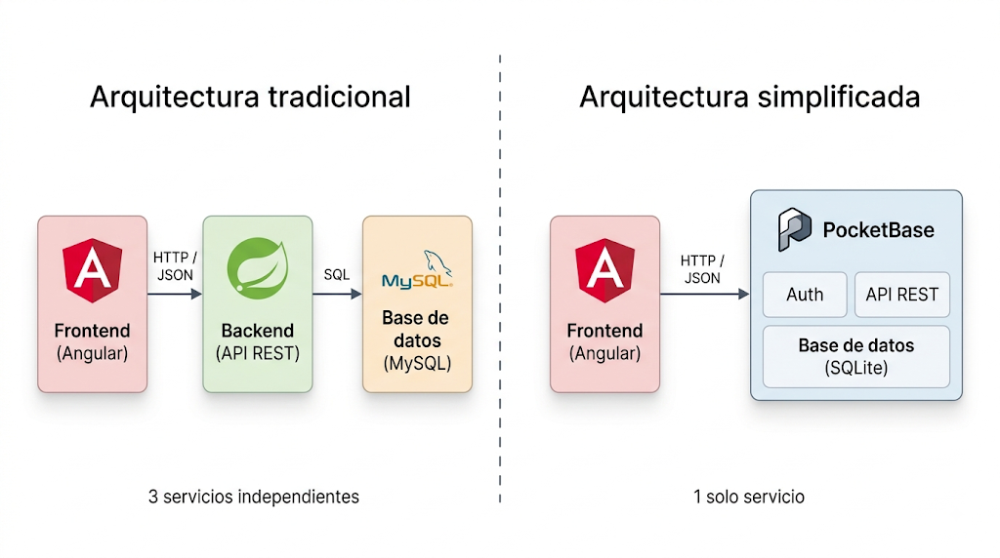

[TOC]

{.rounded-3}

# ¿Qué vamos a hacer?

Vamos a montar nuestro propio servidor de desarrollo desde cero. Nada de magia ni de comandos copiados sin entender qué hacen: vamos a instalar una máquina virtual, meterle Linux (Debian, para ser exactos) y dejarla lista para trabajar como si fuera un servidor de verdad.

Spoiler: no hace falta ser un experto en Linux para esto. Vamos a ver lo justo y necesario para no perdernos, ni más ni menos.

# ¿Por qué un servidor de desarrollo?

Seguro que te suena esto: empiezas un curso, no tienes ni idea de qué es un backend, un frontend o una API, y poco a poco vas montando cosas... todas en tu propio ordenador, todas en `localhost`. La base de datos en tu PC, la API en tu PC, el frontend en tu PC. **Todo en el mismo sitio, todo muy cómodo.**

**El problema es que eso no es *para nada* como funciona una aplicación de verdad**. En un proyecto real, cada pieza suele vivir en su propio rincón: un servidor para la base de datos, otro para la API, otro para el frontend... y todos hablando entre sí a través de la red, no compartiendo carpeta como buenos vecinos.

Así que vamos a hacer algo distinto: crear un **servidor de desarrollo** separado de tu Windows (o el sistema que uses), donde iremos instalando las herramientas que necesitemos. La idea es:

- 🧩 Que se te quede grabado que una app real está hecha de **piezas separadas que se comunican**, no de todo mezclado en un mismo `localhost`.
- 🌐 Acercarte, aunque sea un poquito, a cómo funciona una infraestructura real.
- 🐧 De paso, perderle el miedo a Linux y a manejar un servidor, sin que esto se convierta en un curso de sysadmin (que no lo es).

{.rounded-3}

# ¿Qué vamos a montar?

Primero, la base: una máquina virtual con **Debian** en **VirtualBox**, que será nuestro servidor de desarrollo particular.

Sobre esa base instalaremos **PocketBase**, una herramienta que nos da de un plumazo base de datos (SQLite por debajo), API y panel de administración. Vamos a instalarlo primero "a pelo", directo en el sistema, para entender bien qué es y cómo funciona sin capas intermedias.

> [!NOTE]
> Una vez que PocketBase esté funcionando y lo hayamos entendido, daremos un paso más: instalarlo también usando **Docker**. Es un contenido algo más avanzado, así que si el curso va justo de tiempo o el ritmo es más tranquilo, se puede dejar aquí perfectamente. Lo importante ya se habrá visto.

# Requisitos previos

## Técnicos

- 💻 Un ordenador con al menos 4 GB de RAM libres y espacio en disco disponible (recomendado 20 GB o más).
- 📦 [VirtualBox](https://www.virtualbox.org/) instalado.
- 🙌 Ganas de trastear, no hace falta saber Linux de antemano.

## Conocimientos

Si ya te manejas con MySQL a nivel medio (sabes crear una base de datos, tablas, relaciones entre ellas, y usar `INSERT`, `SELECT`, `UPDATE` y `DELETE`), vas sobrado para este bloque. De hecho, te vas a encontrar con menos SQL del que esperas, no con más.

Algunas diferencias que te vas a encontrar respecto a MySQL:

- 🗂️ **Las tablas se llaman "colecciones"**: conceptualmente son lo mismo (una tabla con sus columnas y tipos de datos), pero se crean y gestionan casi siempre desde un panel visual, no escribiendo `CREATE TABLE` a mano.
- 🖱️ **Menos SQL escrito a mano**: la mayoría de operaciones (crear tablas, relaciones, campos, e incluso consultas) se hacen desde el panel de administración o desde la propia API, sin necesidad de escribir sentencias SQL.
- 🔗 **Las relaciones se definen igual conceptualmente**: si entiendes una relación 1 a muchos o muchos a muchos en MySQL, aquí es el mismo concepto, solo cambia la forma de crearla (más visual, menos código).
- 💾 **Por debajo corre SQLite, no un servidor de base de datos aparte**: es decir, la base de datos es un simple archivo, no un servicio independiente al que te conectas por red como haces con MySQL. Esto simplifica mucho el arranque, aunque tiene sus propias particularidades que iremos viendo.

> [!NOTE]
> No hace falta saber SQLite de antemano. Si vienes de MySQL, los conceptos te van a sonar todos: solo cambia la forma en que se aplican.

> [!TIP]
> Si en algún momento necesitas hacer algo muy concreto que no se pueda desde el panel, PocketBase también permite lanzar consultas SQL directamente. Pero para lo básico de este curso, no nos hará falta.

# ¿Qué ganamos con esta solución?

Frente a un backend tradicional (con su servidor de aplicaciones, su motor de base de datos aparte, su capa de autenticación a programar a mano...), esta combinación de servidor de desarrollo + herramienta todo-en-uno tiene varias ventajas para aprender y para prototipar rápido:

- ⚡ **Menos piezas que montar**: base de datos, API REST y autenticación vienen juntas, no hay que levantar y conectar varios servicios por separado.
- 🚀 **Arranque casi inmediato**: en cuestión de minutos tienes una API funcional, sin horas de configuración previa.
- 🔐 **Autenticación lista de fábrica**: registro, login y gestión de usuarios sin escribir esa lógica desde cero.
- 🖥️ **Panel de administración incluido**: puedes ver y editar tus datos desde una interfaz web, sin depender de otra herramienta externa.
- 🪶 **Ligero para el servidor**: no necesita apenas recursos, perfecto para una VM modesta o un equipo con lo justo.
- 🎯 **Foco en aprender el concepto, no la herramienta**: al haber menos partes que configurar, es más fácil centrarse en entender cómo se comunican frontend y backend, que es lo importante aquí.

> [!IMPORTANT]
> Esto no significa que esta solución sustituya a un backend más robusto en un proyecto grande de producción (tipo Spring Boot + MySQL). Es una herramienta estupenda para aprender, prototipar y para proyectos de tamaño pequeño o medio.

