[TOC]


# Introducción

Nuestro objetivo en este apartado, será tener una máquina virtual con Debian mínimo (solo consola, sin entorno gráfico), actualizada y con un par de utilidades básicas instaladas. A partir de aquí trabajaremos siempre desde la consola de la propia VM o bien, conectados por SSH desde Windows para mayor comodidad (poder copiar y pegar comandos, tamaño de la ventana, textos, etc.).

# 1. Instalar VirtualBox

1. Descarga VirtualBox desde [virtualbox.org/wiki/Downloads](https://www.virtualbox.org/wiki/Downloads) para tu sistema operativo.
2. Instálalo con las opciones por defecto.
3. El "Extension Pack" (USB 2.0/3.0, etc.) no es necesario para este proyecto, puedes omitirlo.

# 2. Descargar la ISO de Debian (netinst)

1. Ve a [debian.org/distrib/netinst](https://www.debian.org/distrib/netinst).
2. Descarga la imagen **netinst** de la última versión estable, arquitectura **amd64**.
3. Es una imagen pequeña que descarga los paquetes necesarios durante la instalación — ideal para un sistema mínimo.

> [!caution]
>
> 🐧 La página oficial de Debian no es muy intuitiva 🤓. Por si tienes problemas, aquí te dejo el enlace directo para descargar la última versión estable en fecha de creación de este tutorial.
>
> [💿ISO Debian 13 - amd64 - netinst](https://cdimage.debian.org/debian-cd/current/amd64/iso-cd/debian-13.6.0-amd64-netinst.iso)

# 3. Crear la máquina virtual

En VirtualBox, pulsa **Nueva**.

- **Nombre y sistema operativo:**
  - **Nombre**: `debian-server` (o el que prefieras). 
  - **Carpeta**: Donde quieras que se guarden tu máquina virtual, por defecto `/usuario/VMs`.
  - **Imagen ISO**: déjalo en blanco. Si aquí seleccionamos la ISO de Debian, se activa la instalación desatendida, y no queremos hacer eso.
  - **Tipo**: `Linux`. 
  - **Versión:** `Debian (64-bit)`.
- **Hardware:**
  - **RAM**: `1024 MB (1 GB)`.
  - **Procesadores:** `1 CPU`.
- **Disco duro:** `Crear un disco duro virtual ahora, tamaño dinámico, 10 GB`.
- Pulsamos en <kbd>Terminar</kbd> y ya nos aparecerá nuestra nueva máquina virtual.


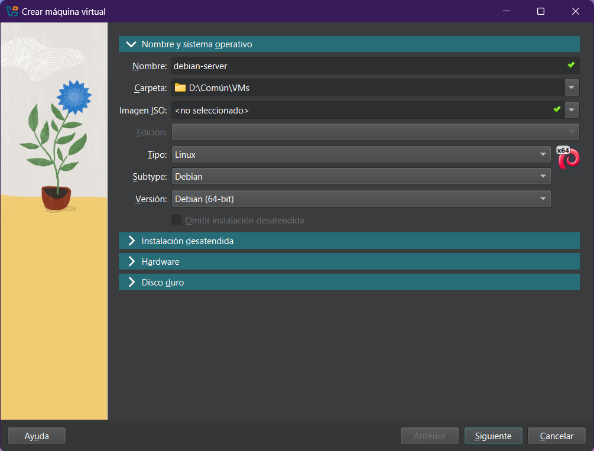{.rounded}

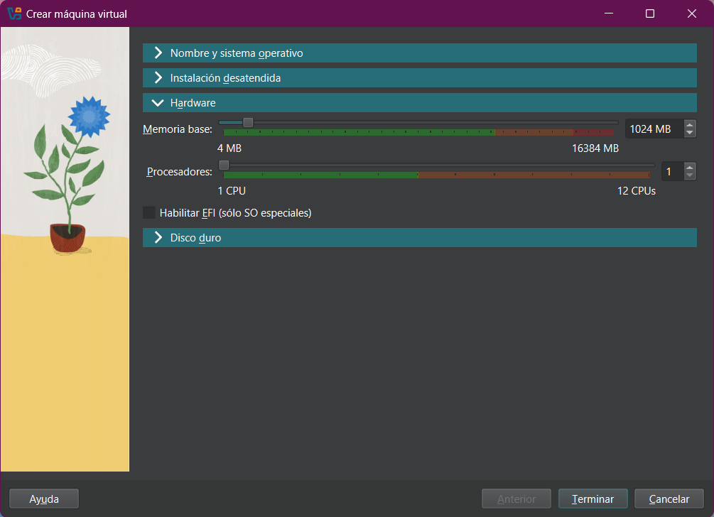{.rounded}

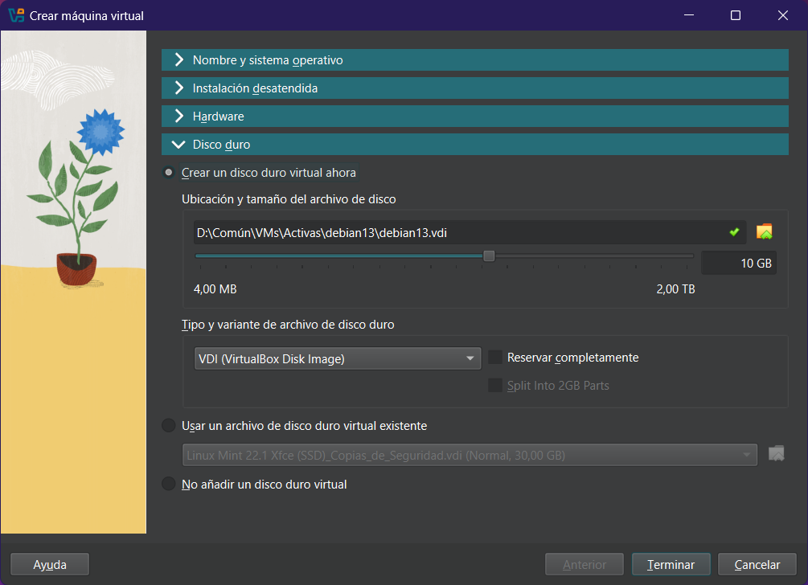{.rounded}

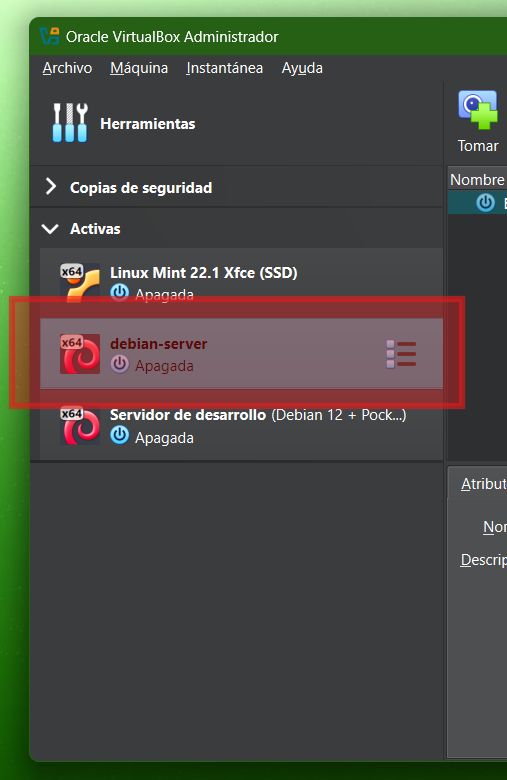{.rounded}

> [!WARNING] 
>
> Estos valores (1 GB de RAM, 1 CPU) son deliberadamente ajustados para que la VM funcione bien incluso en equipos modestos, ya que no tendremos interfaz gráfica. Si aún así, notas que va lenta (por ejemplo, con más servicios corriendo a la vez), se puede aumentar fácilmente en cualquier momento: apaga la VM, ve a **Configuración → Sistema**, y sube la RAM y/o los procesadores. No hace falta reinstalar nada.

# 4. Configurar la VM antes de arrancar

## Almacenamiento

Con la máquina virtual ya creada (pero todavía apagada), vamos a montar la ISO de Debian en la unidad óptica virtual:

1. Seleccionamos la VM y pulsamos en <kbd>⚙️ Configuración</kbd>.
2. Ve a la pestaña **Almacenamiento**.
3. En el panel central, bajo **"Controlador: IDE"**, verás un icono de disco óptico (normalmente pone algo como *"Vacío"* o *"Unidad óptica"*). Haz clic sobre él para seleccionarlo.
4. A la derecha, en el panel de **Atributos**, busca el icono de disco pequeño (📀) junto al desplegable **"Unidad óptica"** y haz clic en él.
5. Se abrirá un menú: elige **"Seleccionar archivo de disco..."**.
6. Navega hasta donde descargaste la ISO de Debian y selecciónala.
7. Verás que ahora, en el panel central, el icono de disco óptico ya no pone "Vacío", sino el nombre del archivo `.iso` que acabas de seleccionar — señal de que está montada correctamente.

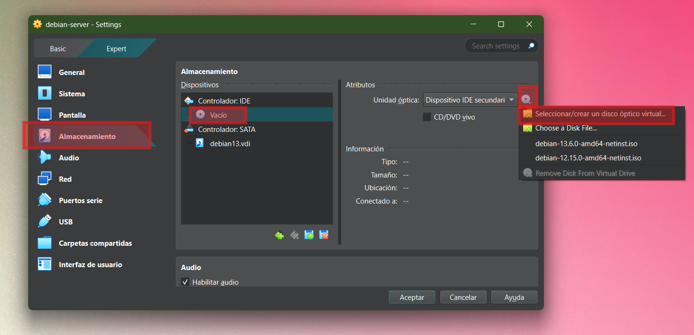{.rounded}

## Red

**Red** → modo **Adaptador puente**. Así la VM obtiene su propia IP dentro de la red local (por ejemplo, `192.168.1.185`), y podéis acceder a ella desde el navegador o el terminal de Windows como si fuera un equipo aparte — algo importante para entender que el servidor no está "dentro" de Windows, sino en una máquina distinta.

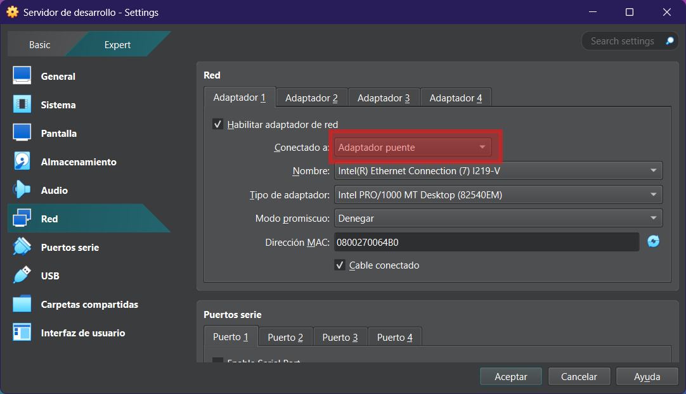{.rounded}

Y pulsamos <kbd>Aceptar</kbd> para terminar con la configuración de la máquina virtual.

> [!WARNING]
> Algunas redes WiFi de aula tienen aislamiento de clientes activado, lo que puede impedir que la VM sea alcanzable en modo Adaptador puente. Más adelante haremos una prueba con `ping` para comprobarlo; si no responde, lo cambiaremos a modo NAT por compatibilidad.

# 5. Instalar Debian

Vamos a instalar Debian usando el instalador gráfico (**Graphical install**), que es más cómodo de seguir en un aula: te permite moverte con el ratón, ver claramente cada pantalla y volver atrás si te equivocas en algo. El resultado final será exactamente el mismo que con el instalador en modo texto: un sistema sin entorno de escritorio, solo con la base y consola.

## 🔌 Arrancar

Al arrancar la VM por primera vez, verás el menú de arranque de Debian. Selecciona <kbd>Graphical install</kbd> con las flechas del teclado y pulsa <kbd>Intro</kbd>.

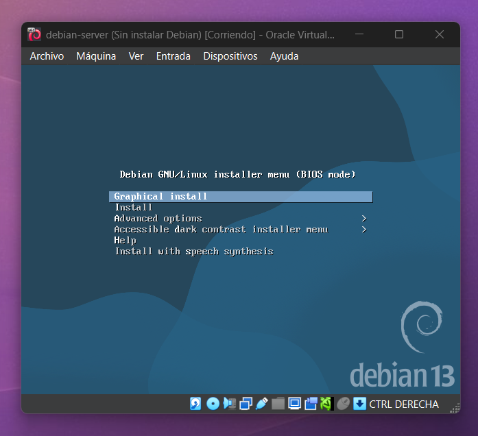{.rounded-3}

> [!tip]
>
> Para “entrar” en la VM basta con hacer clic en su ventana. Si tienes problemas para “salir” de ella, pulsa la tecla <kbd>Control</kbd> derecha (no control + derecha, si no, de las dos teclas control que tiene el teclado, la que está en la derecha 😅).


## 🌐 Idioma

- **Idioma**: elige español (o el idioma que prefieras para el propio instalador y el sistema).
- **Ubicación**: España (o tu país), para que la zona horaria y el formato de fecha/hora se configuren correctamente.
- **Distribución del teclado**: la que corresponda a tu teclado físico (por ejemplo, "Español").

## 🛜 Red

- **Nombre de la máquina (hostname)**: es el nombre con el que identificarás este equipo en la red — por ejemplo `debian-server`. No lleva espacios ni caracteres especiales.
- **Dominio**: puedes dejarlo en blanco. En un aula o red doméstica normal no tenéis un dominio configurado, así que este campo no es necesario.

## 🦸 Usuarios y contraseñas

Aquí el instalador te pedirá primero la contraseña de root y después los datos de un usuario normal.

- **Contraseña de root:** déjala **en blanco** y pulsa continuar. 

  > [!note]
  >
  > Root es el superusuario, con acceso total al sistema sin restricciones, y no es buena práctica trabajar directamente con esa cuenta el día a día. Al dejar la contraseña en blanco, Debian desactiva la cuenta de root automáticamente (no podrás hacer login como root ni usar `su -`).

- **Usuario normal:** rellena tu nombre completo, nombre de usuario y contraseña. Con esta cuenta iniciarás sesión habitualmente.

  > [!tip]
  >
  > Usa credenciales simples, ya que tendrás que escribirlas muchas veces. En un servidor real si que usaríamos más seguras.

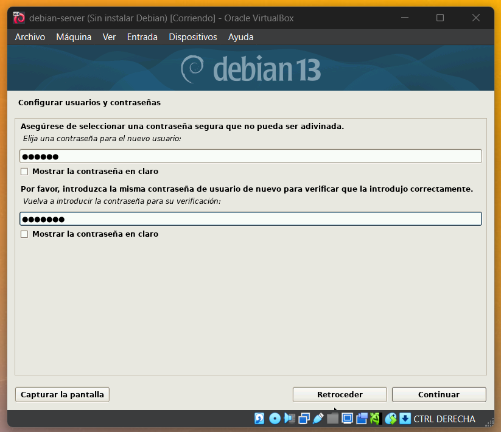{.rounded}

> [!important]
> Al desactivar root, Debian instala automáticamente el paquete `sudo` y añade tu usuario al grupo `sudo`. Esto **no significa que tu usuario se convierta en superusuario permanente** — solo te permite ejecutar comandos puntuales con privilegios elevados anteponiendo `sudo` (por ejemplo, `sudo apt update`), que es la forma recomendada de administrar el sistema. Te ahorra tener que instalar y configurar `sudo` a mano más adelante.

## 🗄️Particionado

- Elige **"Guiado - utilizar todo el disco"**.
- Cuando te pregunte cómo agrupar las particiones, selecciona **"Todos los ficheros en una partición"** (la opción más simple, recomendada para principiantes).
- El instalador te pedirá confirmación para crear la tabla de particiones. Como es un disco virtual nuevo sin nada que perder, selecciona **"Sí"**.
- Confirma los cambios cuando el instalador te muestre el resumen — esto formateará el disco virtual (recuerda que es un disco virtual de la VM, no toca tu disco real de Windows).

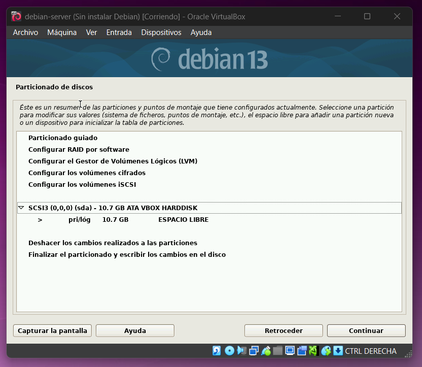{.rounded}

## 📦 Instalación

Ahora se procederá a instalar los paquetes necesarios. 

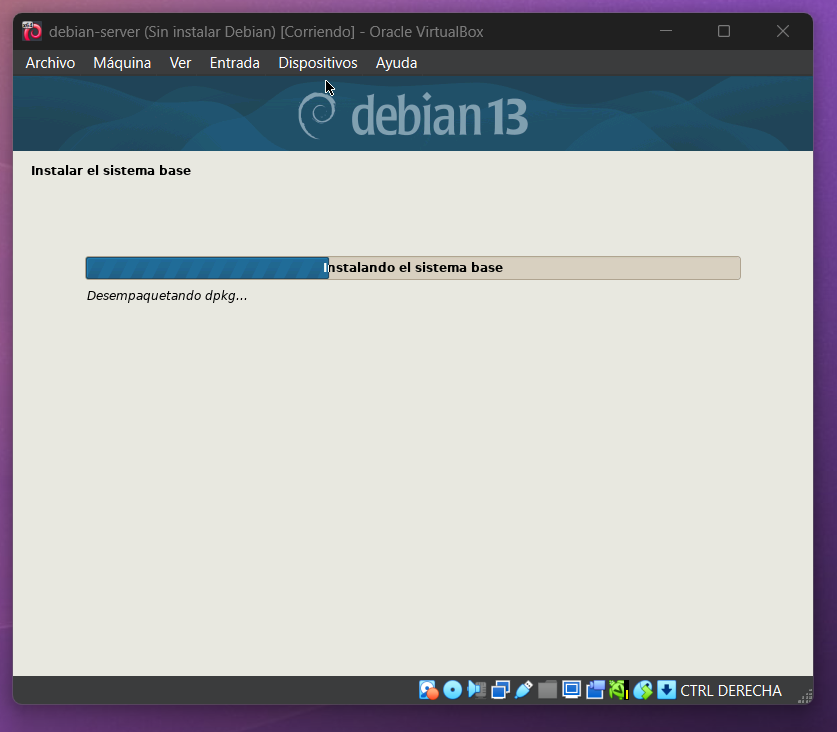{.rounded}

Cuando termine el proceso de instalación, el asistente te hará un par de preguntas adicionales:

- **¿Explorar medios de instalación adicionales?** Selecciona **No** — no necesitas ningún CD o medio extra, todo lo que hace falta se descarga por red.
- **Configuración del gestor de paquetes (mirror):** selecciona **España** como país, y a continuación un servidor de la lista (`deb.debian.org` o cualquiera de los propuestos por defecto funciona bien).
- **Proxy:** Déjalo en blanco, no usaremos ningún proxy.
- **Popularity-contest:** Es para enviar estadísticas anónimas. Seleccionamos **No**.

## 💾 Software adicional

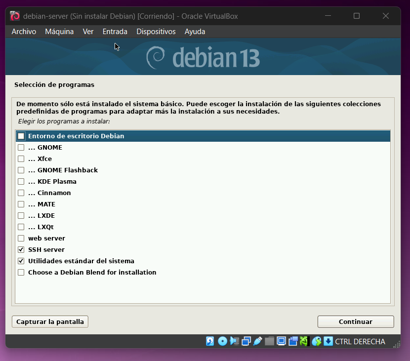{.rounded}

En la pantalla de selección de programas, verás una lista de casillas marcadas por defecto. Aquí es donde nos aseguramos de que el sistema final se queda sin entorno gráfico, y aprovechamos para dejar el SSH ya instalado desde el principio:

- ❌ Desmarca **Entorno de escritorio Debian / Debian desktop environment** y cualquier entorno gráfico (GNOME, Xfce, KDE, etc.).
- ✅ Deja marcado **SSH server** — así lo tienes instalado y arrancado desde el principio.
- ✅ Deja marcado **utilidades estándar del sistema / standard system utilities**.
- ¿Desea instalar el cargador de arranque GRUB? Seleccionamos **SI** y después seleccionamos el disco duro virtual (algo tipo `/dev/sda`).

Termina la instalación y reinicia cuando el instalador te lo pida.

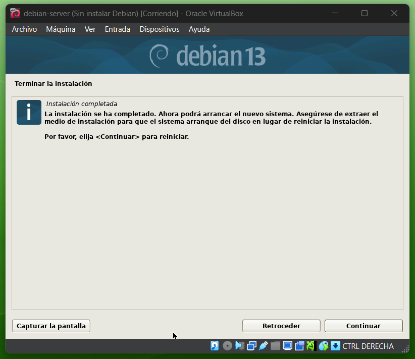{.rounded}

Deberías llegar a una pantalla de login en modo texto — señal de que todo ha ido bien.

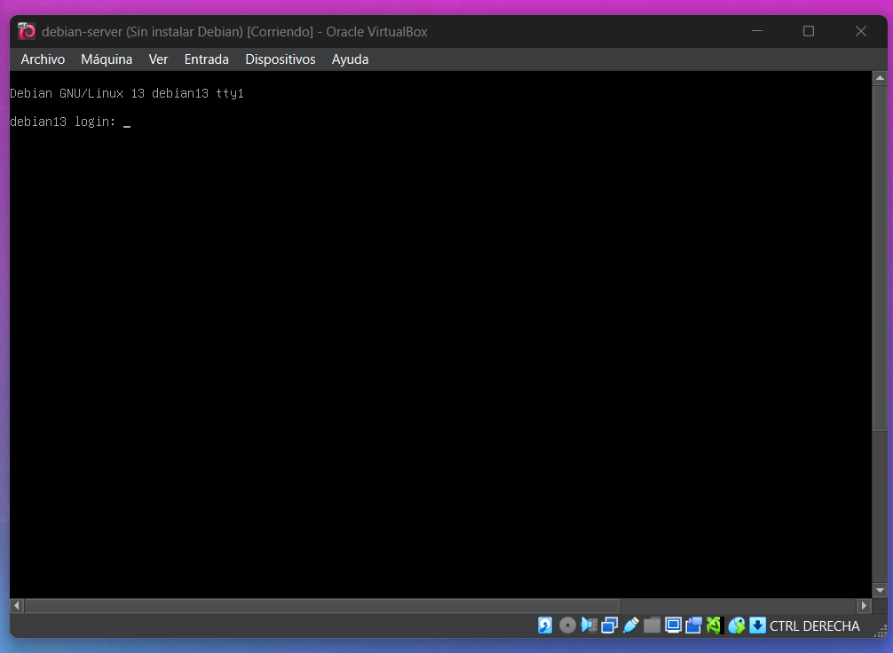{.rounded-3}

Al escribir nuestras credenciales, `usuario` y `contraseña` deberíamos entrar en el sistema, eso implica que todo funciona correctamente 🎉.

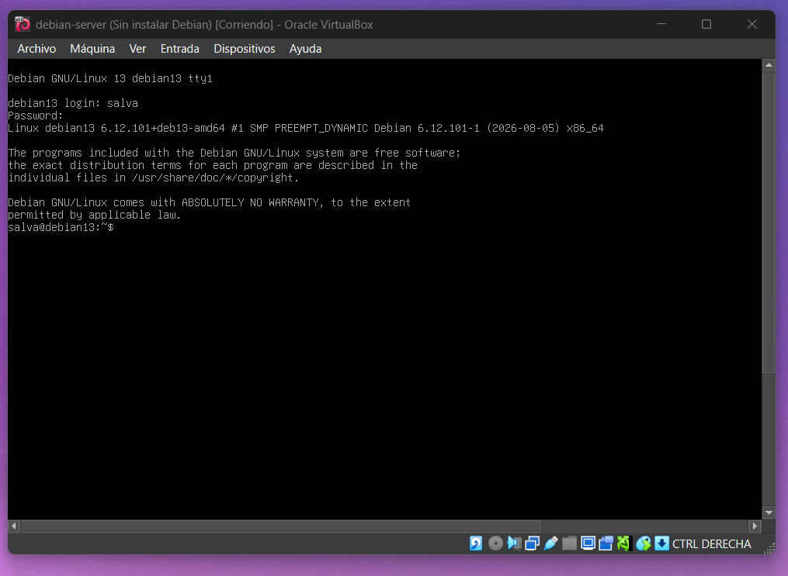{.rounded-3}

## 📸 Snapshot 1

Antes de tocar nada más, apaga la VM con el siguiente comando:

```bash
sudo poweroff
```

Este comando apaga el sistema de forma ordenada, cerrando todos los procesos y servicios correctamente antes de detener la VM.

Y crea una primera instantánea en VirtualBox (`Máquina → Herramientas → Instantáneas → Tomar`) llamada algo como `debian-base-sin-tocar`. Sirve como punto de partida limpio si algo se rompe más adelante.

# 6. Actualizar el sistema

Ya tienes tu usuario configurado con privilegios de `sudo` desde la instalación, así que no hace falta iniciar sesión como root. Ejecuta:

```bash
sudo apt update && sudo apt upgrade
```

- `apt update` → actualiza el índice de paquetes disponibles en los repositorios, **pero no instala nada**.
- `apt upgrade` → instala las actualizaciones disponible (las que detectó `sudo apt update`). Te mostrará un resumen y te pedirá confirmación (pulsa <kbd>s</kbd> y después <kbd>Intro</kbd>).
- Al poner los dos comandos seguidos con el operador `&&`, primero ejecuta uno, y si todo va bien, se ejecuta el segundo. Se pueden hacer por separado o todo junto, como en el ejemplo.

> [!warning]
>
> Como tenemos el Debian recién instalado, lo más seguro es que no se instale nada, pero es importante conocer estos comandos básicos para actualizar el sistema.


# 7. Instalar utilidades básicas

Instala un paquete de herramientas que te serán útiles a lo largo del curso:

```bash
sudo apt install git curl unzip htop vim net-tools tree
```

- 🔧 **git** → sistema de control de versiones, necesario para descargar código de repositorios (por ejemplo, si en algún punto clonamos un proyecto desde GitHub).
- 🌐 **curl** → para hacer peticiones y descargas desde consola, muy útil más adelante para probar la API de PocketBase.
- 📦 **unzip** → para poder descomprimir archivos `.zip` cuando lo necesites.
- 📊 **htop** → monitor de procesos, para ver de un vistazo qué está consumiendo CPU y RAM en tu servidor.
- ✏️ **vim** → editor de texto en consola. Debian ya trae instalado **nano** por defecto (más sencillo de usar), pero vim es el estándar en la mayoría de servidores Linux y te conviene tenerlo disponible.
- 🛠️ **net-tools** → añade comandos clásicos como `ifconfig` y `netstat`, útiles para consultar la red de un vistazo.
- 🌳 **tree** → muestra la estructura de carpetas y archivos en forma de árbol visual. No es imprescindible, pero es muy útil para ver de un vistazo el contenido de un directorio — lo usaremos, por ejemplo, al explorar la carpeta de datos de PocketBase.

> [!TIP]
> Si más adelante necesitas alguna otra utilidad, se instala exactamente igual: `sudo apt install nombre_paquete`.

📸 **Snapshot recomendada aquí:** sistema actualizado y con las utilidades básicas instaladas. Nómbrala algo como `debian-actualizado-listo`. Esta es la base "limpia y a punto" desde la que partirán los siguientes puntos del temario (por ejemplo, antes de instalar PocketBase).

# 8. (Opcional) Acceso por SSH desde Windows

> [!note] 
>
> **SSH** (Secure Shell) es un protocolo que te permite conectarte a la consola de otro equipo a través de la red, de forma cifrada, como si estuvieras sentado delante de él. Lo usaremos para manejar la VM desde una terminal de Windows en lugar de la ventana de VirtualBox.

Esto **no es necesario** para seguir el temario, puedes seguir trabajando siempre desde la consola de la VM en VirtualBox. Se explica aquí solo como comodidad, para poder copiar/pegar comandos largos desde Windows en vez de teclearlos en la ventana de la VM.

Ya instalaste el servidor SSH durante la instalación de Debian, así que solo vamos a comprobar que está activo para conectarte desde Windows.

## Comprobar que el servicio está activo

```bash
sudo systemctl status ssh
```

Deberías ver una línea con `active (running)` en verde. Si es así, el servidor SSH ya está escuchando conexiones. Pulsa <kbd>q</kbd> para salir de esta pantalla de estado.

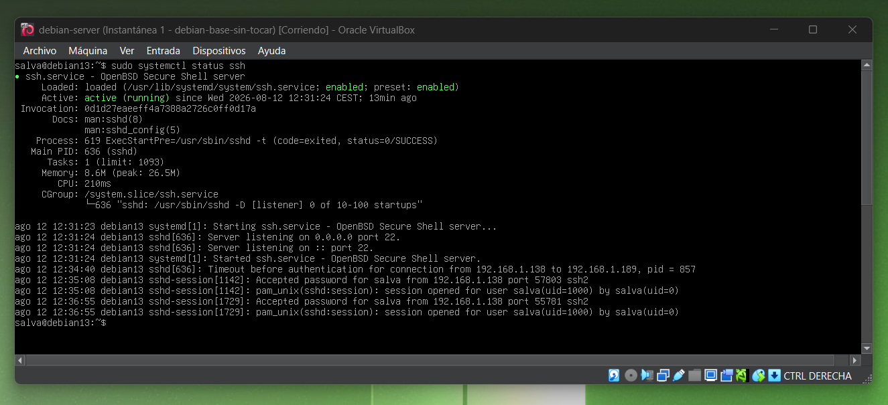{.img-preview}

## Averiguar la IP de la VM

Como estás en modo Adaptador puente, tu VM tiene una IP propia dentro de tu red local (como si fuese un equipo real más). Tienes dos formas de consultarla:

```bash
hostname -I
```

Te muestra directamente la IP (o IPs) del equipo, sin nada más, la forma más rápida y limpia de consultarla.

```bash
ip a
```

Muestra información mucho más detallada de todas las interfaces de red (nombre de la interfaz, máscara, estado, etc.). Es un comando muy usado en administración de sistemas, así que vale la pena conocerlo, aunque para este caso concreto `hostname -I` sea más directo.

Anota la IP que obtengas (por ejemplo, `192.168.1.185`).

> [!TIP]
> Antes de intentar conectar por SSH, prueba primero un `ping` desde Windows a esa IP (`ping 192.168.1.185` en PowerShell o CMD). Si responde, la VM es alcanzable en tu red y el SSH debería funcionar sin problema. Si no responde, revisa la nota de la sección de red del punto 4 sobre redes de aula con aislamiento de clientes.

## Conectar desde Windows

Abre PowerShell o una terminal en Windows y ejecuta:

```bash
ssh tu_usuario@IP_DE_LA_VM
```

Sustituye `tu_usuario` por el usuario que creaste durante la instalación, e `IP_DE_LA_VM` por la IP que anotaste. La primera vez te pedirá confirmar la huella digital del servidor (escribe `yes`), y después te pedirá la contraseña de tu usuario.

Si todo va bien, verás el mismo prompt de la consola de la VM, pero ahora desde tu terminal de Windows y podrás copiar y pegar comandos con normalidad.

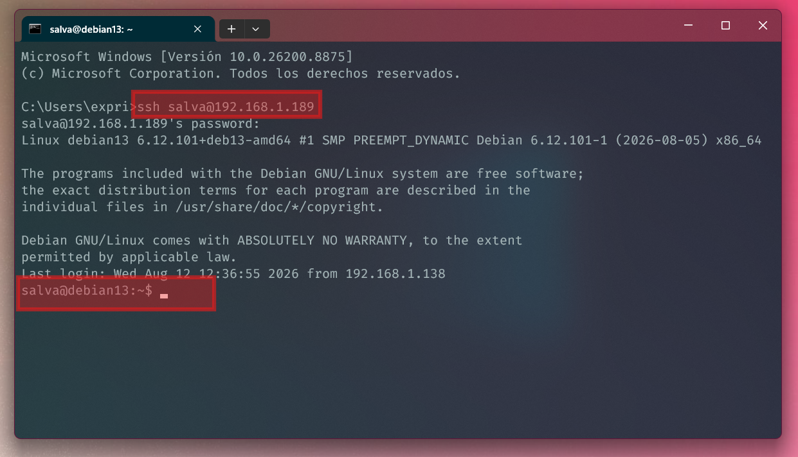{.rounded-3}

> [!tip] Consejo 1
>
> Desde aquí, podrás copiar y pegar comandos, cambiar tamaño y estilo de la fuente, tamaño y color de la ventana, etc, de una forma más fácil y cómoda que desde la propia VM.

> [!tip] Consejo 2
>
> Si vas a conectarte con frecuencia, te puede resultar cómodo crear un perfil específico para Debian dentro de Windows Terminal, o simplemente un acceso directo con el comando `wt.exe ssh tu_usuario@IP_DE_LA_VM`. Así te ahorras escribir el comando cada vez.
>
> 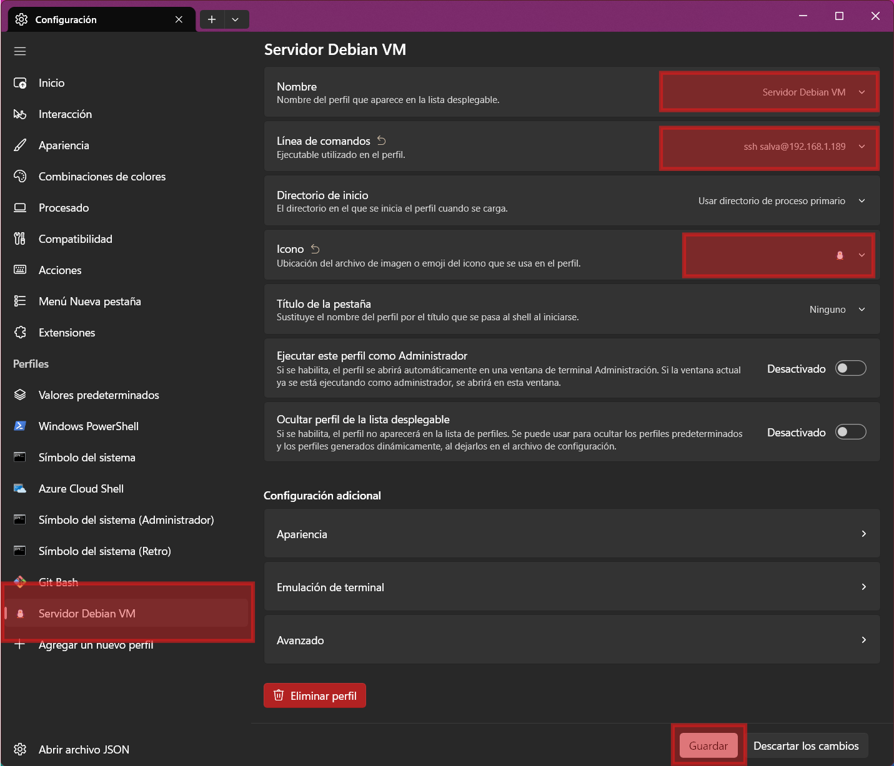

# 9. Snapshot final

Con Debian instalado, actualizado y con las utilidades básicas ya instaladas, este es un buen momento para hacer una instantánea de la VM. Así tienes un punto de partida limpio y estable desde el que arrancar el siguiente punto del temario (instalación de PocketBase), sin tener que repetir todo este proceso por si algo se tuerce.

1. Apaga la VM desde la consola (directa o por SSH). Recuerda, `sudo poweroff`. 
1. En VirtualBox, selecciona la VM (debería aparecer como "Apagada") y ve a **Máquina → Herramientas → Instantáneas**.
1. Pulsa **Tomar** y ponle un nombre descriptivo, por ejemplo `debian-listo-para-pocketbase`.
1. Añade una breve descripción si quieres recordar más adelante qué incluye exactamente (Debian actualizado, git, curl, unzip, htop, vim, net-tools, tree, SSH configurado).

> [!TIP]
> Puedes volver a este punto en cualquier momento seleccionando la instantánea y pulsando **Restaurar**, por ejemplo si algo se rompe durante la instalación de PocketBase o cuando queramos “desinstalar Pocket Base” (es más fácil restaurar este punto que deshacer todo lo que hagamos en el siguiente).

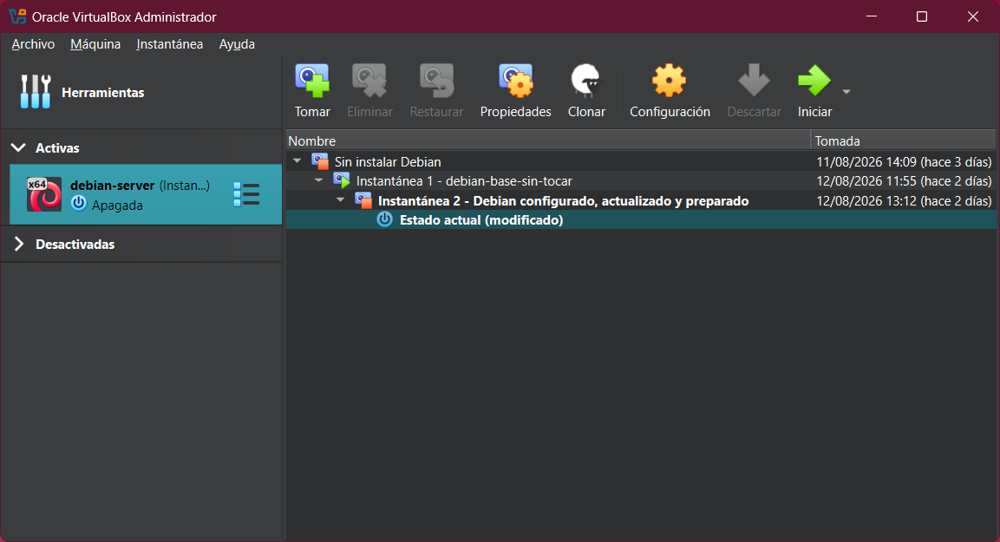{.rounded}