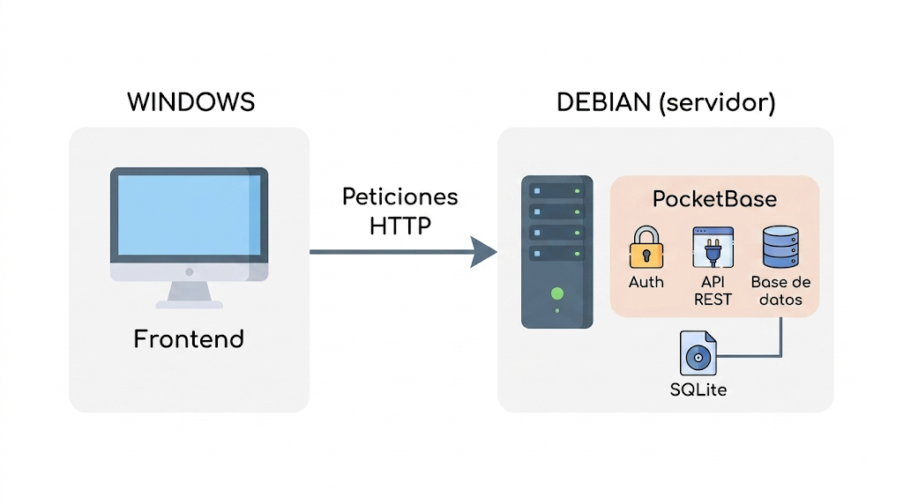

[TOC]

# Introducción

{.rounded}

Antes de instalar nada, conviene tener muy claro el papel de cada pieza, para no mezclar conceptos:

## Debian

**Es el sistema operativo, la base sobre la que corre todo lo demás**. Debian no sabe nada de bases de datos, ni de páginas web, ni de APIs: simplemente te da un sistema Linux funcionando, con sus comandos, sus usuarios, su sistema de archivos. Todo lo que instalemos a partir de ahora (PocketBase incluido) corre encima de Debian, igual que cualquier programa que instalas en Windows corre encima de Windows.

## PocketBase

**Es una aplicación**, un programa como cualquier otro, que nosotros ejecutaremos sobre Debian (también tiene su versión de Windows). La diferencia respecto a lo que quizás conozcas (como una web hecha con PHP + MySQL) es que PocketBase viene todo integrado en un único archivo ejecutable: base de datos, panel de administración web y API REST, todo junto, sin piezas sueltas que instalar y conectar entre sí por separado.

Si conoces MySQL, la comparación te puede ayudar: con MySQL normalmente necesitas instalar el motor de base de datos por un lado, quizás algo como phpMyAdmin para gestionarlo visualmente por otro, y después tu propio código (PHP, Node, etc.) para exponer una API que hable con esa base de datos. Con PocketBase, todo eso ya viene resuelto dentro del mismo ejecutable: lo arrancas, y ya tienes base de datos, panel de administración y API funcionando a la vez.

## SQLite

**Es el motor de base de datos que PocketBase** usa por dentro para guardar los datos. A diferencia de MySQL o PostgreSQL, SQLite no funciona como un servicio aparte que arrancas y detienes de forma independiente (no verás nada como `systemctl status mysql`); en vez de eso, es una base de datos que vive directamente en un archivo dentro del propio sistema de ficheros, y PocketBase lee y escribe en ese archivo directamente. No lo vas a instalar tú por separado, ni lo vas a configurar aparte: viene integrado dentro del binario de PocketBase y funciona de forma automática.

> [!TIP] Resumen
> Debian es la casa, PocketBase es el inquilino que vive dentro y hace todo el trabajo, y SQLite es el archivador donde PocketBase guarda sus papeles. Tú solo vas a instalar y arrancar a PocketBase, el resto ya viene incluido.

# Descargar e instalar PocketBase

## Cómo vamos a organizar las aplicaciones

Antes de descargar nada, conviene entender cómo vamos a organizar esto, porque es diferente a lo que quizás esperas si vienes de MySQL. En MySQL tienes un único servidor y, dentro de él, puedes crear varias bases de datos distintas. 

En PocketBase no funciona así: **cada carpeta con su propio binario es una aplicación completa e independiente**, con su propia base de datos SQLite dentro. Si en el futuro quieres montar una segunda app, no "creas otra base de datos" dentro de la instalación actual, sino que descomprimes otra copia del binario en otra carpeta y la arrancas por separado.

Vamos a usar esta estructura de carpetas:

```texto
/opt/pocketbase/
├── pocketbase_X.X.X_linux_amd64.zip   (el .zip descargado, se queda aquí)
└── apps/
    └── demo/
        ├── pocketbase                  (binario descomprimido)
        └── pb_data/                    (se crea solo al arrancar, aquí vive el SQLite)
```

- **`/opt/pocketbase/`** es donde guardamos el `.zip` descargado, una sola vez. Lo dejamos ahí como "almacén", para poder crear futuras aplicaciones sin tener que descargarlo de nuevo cada vez.
- **`apps/`** contendrá una carpeta por cada aplicación/backend independiente que montemos a lo largo del curso.
- **`demo/`** es el nombre que le vamos a dar a esta primera aplicación de prueba. Dentro tendrá su propio binario `pocketbase` y, en cuanto lo arranquemos, su propia carpeta `pb_data` con la base de datos.

> [!important]
> Tener cada aplicación en su propia carpeta independiente tiene varias ventajas prácticas: 
>
> - Si quieres eliminar una aplicación, borras su carpeta y ya está, sin afectar a las demás. 
> - Si quieres moverla a otro servidor, copias esa carpeta entera y la arrancas en el nuevo sitio. 
> - Para hacer una copia de seguridad, te basta con comprimir o copiar esa carpeta completa, sin tener que exportar bases de datos ni configurar nada aparte.

## Crear la estructura de carpetas

Como `/opt` es una carpeta del sistema (no de tu usuario), necesitas `sudo` para crear cosas dentro de ella:

```bash
sudo mkdir -p /opt/pocketbase
```

> [!NOTE]
> `sudo` te permite ejecutar un comando con permisos de administrador. Como `/opt` pertenece al sistema y no a tu usuario, sin `sudo` no podrías crear nada ahí dentro.

Para no tener que usar `sudo` en cada paso siguiente, hacemos que esa carpeta pase a ser tuya:

```bash
sudo chown -R $USER:$USER /opt/pocketbase
```

Comprueba que el cambio se ha aplicado correctamente:

```bash
ls -l /opt
```

Deberías ver una línea como esta, donde tu usuario aparece como propietario de la carpeta `pocketbase` (en vez de `root`):

```texto
drwxr-xr-x 2 tu_usuario tu_usuario 4096 ago 18 12:00 pocketbase
```

Por último, entra en la carpeta: 

````bash
cd /opt/pocketbase 
````

 

> [!CAUTION]
>
> A partir de aquí, todos los comandos siguientes son con **rutas relativas**, y asumen que estás situado dentro de `/opt/pocketbase`. Si en algún momento cierras la sesión, te desconectas por SSH o simplemente te mueves a otra carpeta, recuerda volver a hacer `cd /opt/pocketbase` antes de continuar.

## Obtener la URL de descarga

Desde el navegador de Windows, ve a la página de releases de PocketBase:

[github.com/pocketbase/pocketbase/releases](https://github.com/pocketbase/pocketbase/releases)

Busca la versión más reciente y, dentro de la sección <kbd>Assets</kbd>, localiza el archivo con el nombre `pocketbase_X.X.X_linux_amd64.zip` (sustituye `X.X.X` por el número de versión que veas). Haz clic con el botón derecho sobre ese enlace y selecciona <kbd>Copiar dirección del enlace</kbd>.

> [!NOTE]
> Asegúrate de copiar la versión para **linux_amd64**. Hay otras versiones para Windows, Mac o para otras arquitecturas (arm64), que no nos sirven para esta VM.

## Descargar en la VM

Conectado a la VM (por consola o SSH), entra en la carpeta que acabas de crear y descarga ahí directamente el `.zip` con `wget`, seguido de la URL que has copiado. Por ejemplo, para descargar la versión 0.39.11 (la más reciente en el momento de escribir esto):

Una vez situados en `/opt/pocketbase`, nos descargamos ahí la última release:

```bash
wget https://github.com/pocketbase/pocketbase/releases/download/v0.39.11/pocketbase_0.39.11_linux_amd64.zip
```

> [!TIP]
> Cuando tú lo hagas, probablemente exista una versión más nueva. No pasa nada: simplemente pega la URL que copiaste en el paso anterior en lugar de esta.

Comprueba que el archivo se ha descargado:

```bash
ls
```

Deberías ver el archivo `.zip` en la carpeta.

## Crear la primera app y descomprimir

Crea la subcarpeta para esta primera aplicación de prueba, usando la ruta completa para asegurarnos de que se crea exactamente donde toca:

```bash
mkdir -p /opt/pocketbase/apps/demo
```

> [!note]
>
> Si ya estábamos en `/opt/pocketbase`, podemos usar rutas relativas, haciendo `mkdir -p apps/demo`.

Descomprime el `.zip` directamente dentro de `apps/demo`:

```bash
unzip pocketbase_*.zip -d apps/demo
```

Esto extrae el binario `pocketbase` (y algún archivo más, como la licencia) dentro de `apps/demo/`.

Por último, dale permisos de ejecución al binario:

```bash
chmod +x apps/demo/pocketbase
```

> [!NOTE]
> `chmod +x` marca el archivo como ejecutable. Sin este permiso, Linux no te dejaría arrancarlo aunque el archivo esté ahí.

Por último, sal a `/opt` y comprueba que la estructura ha quedado como esperabas:

```bash
cd /opt
tree pocketbase
```

Deberías ver algo parecido a esto:

```texto
pocketbase
├── apps
│   └── demo
│       ├── LICENSE.md
│       └── pocketbase
└── pocketbase_0.39.11_linux_amd64.zip
```

> [!CAUTION]
> Recuerda que ahora estás situado en `/opt`, no en `/opt/pocketbase`. Si vas a seguir con más comandos relativos a la carpeta de PocketBase, haz primero `cd pocketbase` para volver a entrar.

{{ En el siguiente bloque nos queda arrancarlo y echarle un vistazo al panel. Para arrancarlo, la primera instrucción será situarnos en la carpeta de la app que queramos arrancar, en nuestro caso apps/demo}}
