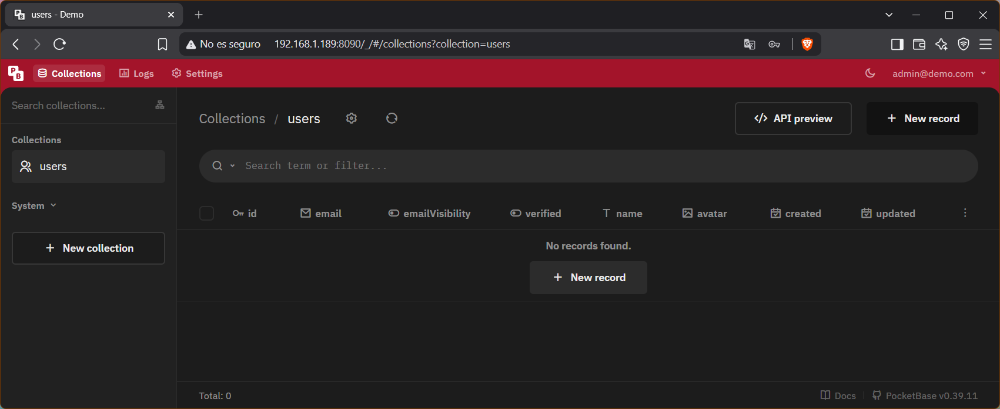

[TOC]

# Colecciones

Hasta ahora has visto PocketBase por fuera: cómo instalarlo, cómo arrancarlo, y le has echado un vistazo rápido al panel de administración. Ha llegado el momento de entrar de verdad en el corazón de cualquier backend: los datos.

Cuando una aplicación necesita guardar información (usuarios, productos, mensajes, lo que sea), esa información no puede vivir en la memoria del programa sin más, porque se perdería en cuanto el servidor se apague o se reinicie. Necesita guardarse en algún sitio de forma permanente y organizada. Eso es justo lo que hace una base de datos, y PocketBase trae la suya integrada.

En PocketBase, esa organización se hace a través de **colecciones**. Una colección es, básicamente, un conjunto de elementos del mismo tipo. Por ejemplo, si tu aplicación necesita guardar libros, tendrías una colección llamada `libros`, y dentro de ella, cada libro individual sería un **registro**. Cada registro se compone a su vez de **campos**: propiedades concretas de ese elemento, como el título, el autor o el año de publicación.

Puedes imaginarlo como una hoja de cálculo: la colección sería la hoja entera, cada fila sería un registro (un libro concreto), y cada columna sería un campo (título, autor, año...).

{.rounded}

> [!NOTE]
> Si ya conoces MySQL u otra base de datos relacional, esto te va a sonar mucho: 
> $$
> coleccion = tabla
> $$
>
> $$
> registro = fila
> $$
>
> $$
> campo = columna
> $$
>
> La lógica de fondo es la misma, cambia sobre todo la forma de trabajar con ella, ya que en PocketBase todo se gestiona desde un panel visual, sin escribir SQL.

Lo interesante de PocketBase es que, en el momento en que creas una colección, automáticamente tienes disponible una API REST completa para trabajar con ella (crear, leer, modificar y borrar registros) sin escribir ni una línea de código de backend.

Por ejemplo, si tuvieras una colección llamada `libros`, podrías consultar todos sus registros simplemente visitando esta URL desde el navegador:

```http
http://127.0.0.1:8090/api/collections/libros/records
```

Y la respuesta que recibirías sería un JSON con toda la información, algo parecido a esto:

```json
{
  "page": 1,
  "perPage": 30,
  "totalItems": 2,
  "totalPages": 1,
  "items": [
    {
      "id": "abc123",
      "titulo": "El Quijote",
      "autor": "Miguel de Cervantes",
      "año": 1605
    },
    {
      "id": "def456",
      "titulo": "Cien años de soledad",
      "autor": "Gabriel García Márquez",
      "año": 1967
    }
  ]
}
```

No te preocupes por entender cada detalle ahora mismo, todavía no hemos creado ni la colección ni sus campos. Es solo un adelanto de lo que vas a tener disponible sin esfuerzo extra en cuanto termines de definir tu colección.

# Qué vamos a construir

Para practicar esto de forma simple, vamos a modelar una biblioteca. Es un ejemplo sencillo pero que se puede extrapolar fácilmente a cualquier negocio parecido: un alquiler de coches, una sala de reservas, un videoclub (👴)... La estructura de fondo (alguien que toma prestado algo, durante un tiempo) es la misma en todos los casos.

En este tema vamos a trabajar con dos colecciones:

- 🧑‍🤝‍🧑 **users**: la colección de socios de la biblioteca. Ya la tienes creada por defecto desde que instalaste PocketBase, así que aprovecharemos para verla de cerca.
- 📖 **libros**: una colección nueva que vas a crear tú desde cero, con los libros disponibles.

> [!NOTE]
> Vamos a crear estas colecciones de prueba (`libros`, y más adelante `prestamos`) sobre la misma instancia `demo` que ya tienes montada desde el tema anterior. No hace falta crear una instancia nueva para esto: la idea es aprender cómo funcionan las colecciones sin complicarte con pasos de instalación que ya conoces.

> [!important]
> Por ahora, cada colección que vas a crear es completamente independiente de las demás y no se relacionan entre sí.

# La colección `users`

Cuando creaste tu superusuario en el tema anterior, en realidad ya estabas usando PocketBase de una forma muy concreta: rellenando un registro. Pero ese superusuario no vive en una colección normal, vive en una colección especial de administración (`_superusers`) separada del resto.

`users`, en cambio, es distinta: es una colección normal (la puedes ver, editar, incluso borrar si quisieras), pero viene creada por defecto porque casi cualquier aplicación necesita gestionar usuarios que se registran, inician sesión, etc. PocketBase la trae ya montada de fábrica para ahorrarte ese trabajo.

Vamos a echarle un vistazo.

## Explorando la colección

Entra en el panel de administración y, en el menú de la izquierda, haz clic en **users**.

{.rounded}

> Captura: panel con la colección `users` seleccionada, mostrando la tabla vacía.

Si te fijas en las columnas que ya tiene por defecto, verás algo como:

- `id`: identificador único de cada registro, generado automáticamente
- `email`: el correo del usuario
- `emailVisibility`: si ese email es visible públicamente para otros usuarios o no
- `verified`: si el usuario ha confirmado su email o no
- `created` / `updated`: fechas automáticas de creación y última modificación

> [!NOTE]
> Estos dos últimos campos (`created` y `updated`) no son exclusivos de `users`: cualquier colección que crees en PocketBase los lleva incorporados de serie, sin que tengas que añadirlos tú.

## Por qué `users` es una colección "especial"

A simple vista parece una colección más, pero tiene un par de diferencias importantes respecto a las que vas a crear tú mismo:

- 👮‍♀️ Está pensada para **autenticación**: sus registros pueden "iniciar sesión" contra la API (con email y contraseña), algo que una colección normal no puede hacer
- 🔐 Sus reglas de acceso vienen más restringidas por defecto, precisamente por guardar datos sensibles como contraseñas o emails

En PocketBase, este tipo de colección se llama **colección de autenticación** (`auth`), y se distingue visualmente en el panel con un icono distinto (👥) al de las colecciones normales (📂).

## Crea tu primer socio

Vamos a añadir un registro de prueba, como si fuera el primer socio de la biblioteca.

Dentro de la colección `users`, busca el botón para crear un nuevo registro <kbd>New record</kbd>.

{{ POR AAQUI, mira si le vas a poner una captura del botón o como está un poco más arriba no le pones nada }}

> Captura: botón de "Nuevo registro" en la colección `users`.

Rellena al menos:

- **email**: un correo cualquiera, por ejemplo `socio1@biblioteca.com`
- **password** y **confirmar contraseña**: cualquier contraseña de prueba

Guarda el registro. Verás que aparece en la tabla, con su `id` generado automáticamente.

> [!TIP]
> No hace falta que sea un email real ni una contraseña segura, es solo un dato de prueba para que la colección no esté vacía cuando probemos la API más adelante.